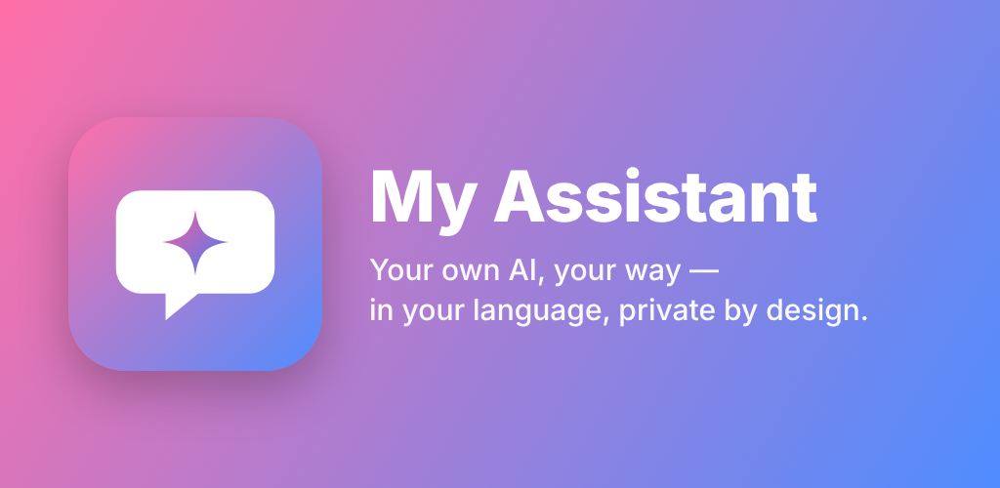

# My Assistant

**A polished chat client for your own API key (BYOK). Paste a key from any of 10 providers — OpenAI, Anthropic, Gemini, DeepSeek, Kimi, Qwen, Mistral, xAI, Groq, OpenRouter — and every feature is yours for €1.99 a month, with no cut of your tokens.**

[Open the web app](https://myassistant.aplusz.app/en/) · [Google Play](https://play.google.com/store/apps/details?id=app.aplusz.myassistant) · [Microsoft Store](https://apps.microsoft.com/detail/9N3BPLJDQ24W)

---

## Bring your own key

Paste a key from **OpenAI, Anthropic, Google Gemini, DeepSeek, Mistral, xAI, Groq, OpenRouter, Moonshot or SiliconFlow**. My Assistant recognises the provider, checks the key with it, stores it encrypted and picks a model you can change anytime. Your key goes only to its own provider, and your AI usage is billed by that provider, from your own account.

No key yet? Top up built-in **My Assistant credit** and start chatting right away.

## Tuned per provider — the cheap models shine

Most clients send the same call to every provider. My Assistant shapes each call for the provider behind the key, and that is where DeepSeek, Kimi (Moonshot) and Qwen (SiliconFlow) pull ahead:

- **The right model for the job** — code, maths, multi-step work, comparisons and long pieces go to the reasoning model; everyday questions stay on the chat model, so reasoning prices are paid only where reasoning helps
- **Settings per task** — internal checks run cold and in JSON mode, reasoning runs cooler, conversation runs warmer
- **A strict contract for open models** — language locked to yours, answer first, every ask numbered, exact numbers and code, a silent self-check before the reply lands
- **Retries that fit each provider** — a longer first-token wait for reasoners, one retry on 429/503, a refused parameter dropped and the call sent again instead of failing
- **Thinking on SiliconFlow only when the question earns it**

## Never misses a part of your message

A separate light pass lists every ask in your message before the reply, and checks afterwards that each one was answered — anything missed is answered in the same bubble.

## Files of any size, byte-exact

Attach a 5 MB file and ask for a change: the model sends only the edits, and your device places them into the whole file it holds — encoding, line endings, indentation and the last newline kept exactly. Every changed file comes back ready to replace the old one. A structure check (JSON, JS, XML, HTML) runs on the result, with one quiet second look when something is off.

## Stays connected

Device resend, retry at the edge, a sister model on the same key, carry-on mid-reply, and your other keys as fallback — a reply on its way arrives.

## Built to keep AI bills low

Only the recent part of a chat travels with each message, files are sent once, and your provider's cache discount applies — so everyday chat on your own key costs cents a month.

## What you get

- **Several keys, one tap to switch** — with the balance shown where the provider reports it, in your own currency
- **Files in and out** — text, code and images go to your AI; pages and code come back as files to download
- **Streamed replies** with clean formatting, colour-coded code panels and one-tap copy
- **Search across every chat**, branch a chat from any message, pin the chats you use most
- **Your chats on up to 3 devices**, synced straight between them, end-to-end encrypted
- **Saved replies, reminders and check-ins** — your assistant asks how the exam or the trip went
- **Pictures from your own OpenAI or xAI key**
- **Memory on your device** — facts you state are noted by your own key and ride along later; one list in Settings to keep, forget or add
- **Calendar and reminders from the chat** — "Remind me Friday at 3" sets it; a month view with export to .ics
- **Live web search on your own key** where the provider supports it, with a sources line
- **Projects** to group chats, a file library per chat with versions, and a workbench to edit any result in place
- **Quick asks under every reply** — Shorter · Simpler · As a list · In your language · Teach this, step by step
- **20 languages and 8 themes** — replies follow the language you type in

## Pricing

A free preview to try it, then:

| Plan | Price |
| --- | --- |
| Monthly | €1.99 a month |
| Yearly | €19.99 a year — two months free |
| For two | €2.99 a month — two accounts, each with their own chats, keys and devices |

Every plan has every feature, with no message limits. On the web it's paid with PayPal; in the Google Play app, with Google Play.

## Private by design

Your chats, files and reminders live on your own devices. The app runs cookie-free and tracker-free, and your account deletes permanently whenever you choose.

## Get it

- Web: **https://myassistant.aplusz.app/en/**
- Android: **[Google Play](https://play.google.com/store/apps/details?id=app.aplusz.myassistant)**
- Windows: **[Microsoft Store](https://apps.microsoft.com/detail/9N3BPLJDQ24W)**

Made by **Verge Heights** · contact@aplusz.app
